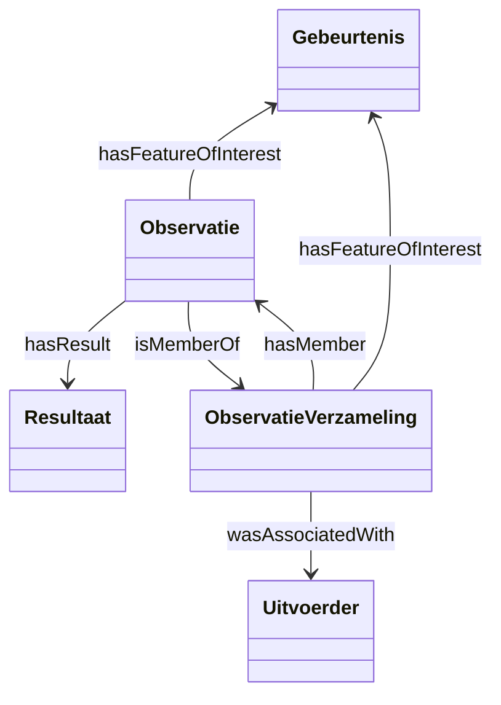

# Operationele gegevens

!!! info "Operationele stroom"
    Deze pagina beschrijft gebeurtenissen, observaties, observatieverzamelingen en resultaten. De structurele entiteiten waaraan ze kunnen refereren, staan in [Systemen](./systemen.md) en [Exploitant en exploitatie](./exploitant.md). De grens tussen beide stromen staat in [Twee stromen](./datamodel.md).

!!! warning "Analyse nog lopende"
    De analyse van operationele gegevens is nog lopende. De informatie in dit document kan wijzigen na afronding van de analyse.

Operationele gegevens beschrijven wat er tijdens een exploitatie gebeurt en welke waarnemingen of metingen daarover zijn verzameld. Het model gebruikt de SOSA/SSN-structuur: een **gebeurtenis** is het onderwerp van een of meer **observaties**; een observatie verwijst naar haar **resultaat**. Observaties kunnen samen in een **observatieverzameling** staan. Een **uitvoerder** kan aangeven wie de verzameling of observatie heeft uitgevoerd.

## 0. Verband met de structurele gegevens

Operationele gegevens kunnen naar structurele gegevens verwijzen, bijvoorbeeld:

| Relatie | Betekenis |
|---|---|
| `prov:wasDerivedFrom` | De gebeurtenis is afgeleid van het proces waaruit ze voortkomt. |
| `sosa:madeBySensor` | Een observatie verwijst naar het meetpunt of systeem dat de waarneming deed. |
| `riepr:aangifte` | Een observatie of verzameling verwijst naar de bijbehorende aangifte. |

De gebeurtenis, observatie, verzameling en het resultaat vormen samen de operationele beschrijving. Zie [Twee stromen](./datamodel.md) voor de scheiding tussen operationele en structurele gegevens.

## 1. Het observatiepatroon

```text
riepr:Gebeurtenis (sosa:FeatureOfInterest)
  ├── sosa:hasFeatureOfInterest ← riepr:Observatie
  │     └── sosa:hasResult → riepr:Resultaat (qb:Observation)
  └── sosa:hasFeatureOfInterest ← riepr:ObservatieVerzameling
        ├── sosa:hasMember → riepr:Observatie
        └── prov:wasAssociatedWith → riepr:Uitvoerder
```

Een observatie kan ook zonder verzameling voorkomen. Een verzameling kan meerdere observaties bevatten, en kan ook geneste verzamelingen bevatten.

## 2. Gebeurtenissen: Emissie, Onttrekking

Een `riepr:Gebeurtenis` is datgene waarover gegevens worden verzameld. Voorbeelden zijn een emissie, onttrekking of verbruik. In SOSA-termen fungeert de gebeurtenis als `sosa:FeatureOfInterest`: observaties en verzamelingen verwijzen ernaar met `sosa:hasFeatureOfInterest`.

Een concrete gebeurtenis kan een specifiek type hebben, zoals `riepr:Emissie`. Ze kan ook herleidbaar zijn tot een structureel proces via `prov:wasDerivedFrom`. De gebeurtenis is niet hetzelfde als het fysieke punt of systeem waarop een meting plaatsvindt; dat systeem kan via `sosa:madeBySensor` bij de observatie horen.

## 3. Observaties

Een `riepr:Observatie` is een waarneming of meting. De belangrijkste verbanden zijn:

| Predicaat | Doel | Gebruik |
|---|---|---|
| `sosa:hasFeatureOfInterest` | `riepr:Gebeurtenis` | De gebeurtenis waarop de observatie betrekking heeft. |
| `sosa:observedProperty` | concept | Wat is waargenomen of gemeten; de invulling hangt af van de rapportagestroom. |
| `sosa:hasResult` | `riepr:Resultaat` | Het resultaatrecord van de observatie. |
| `sosa:madeBySensor` | systeem | Optioneel meetpunt of ander systeem dat de observatie uitvoerde. |
| `sosa:isMemberOf` | `riepr:ObservatieVerzameling` | Optionele verzameling waartoe de observatie behoort. |

Waar van toepassing kan ook het tijdstip bij de observatie worden vastgelegd. De methode en overige rapportagecontext kunnen afhankelijk van het schema op de observatie, de verzameling of het resultaat terechtkomen.

## 4. Resultaten

Een `riepr:Resultaat` is het resultaatrecord van een observatie. Het is zowel een `sosa:Result` als een `qb:Observation`. De observatie verwijst ernaar via `sosa:hasResult`.

De eigenschappen op een resultaat zijn **niet één vaste set velden**. Ze hangen af van de gegevens die worden verzameld en de betreffende rapportagestroom. Daarom somt deze documentatie de resultaatpredicaten niet op; afnemers bepalen aan de hand van de gegevens en de bijbehorende codelijsten welke eigenschappen relevant zijn.

## 5. Uitvoerder

Een `riepr:Uitvoerder` is een agent die een of meer observaties heeft uitgevoerd. De koppeling gebruikt `prov:wasAssociatedWith`. In een rapportage kan de uitvoerder aan een observatieverzameling worden gekoppeld, zodat die geldt voor de waarnemingen in de verzameling; waar nodig kan de koppeling ook rechtstreeks aan een observatie staan.

## 6. Procedures: meetproces en bepalingsmethode

Een structureel **meetproces** beschrijft de procedure in de exploitatie en kan een meetpunt implementeren. De **bepalingsmethode** beschrijft hoe een meting is uitgevoerd. Dat zijn verschillende zaken. In de POC-voorbeelden hangt de plek waar methode-informatie wordt opgeslagen af van de rapportagestroom; zie ook [Codelijsten](./codelijsten.md) voor de gebruikte operationele concepten.

## 7. Observatieverzamelingen

Een `riepr:ObservatieVerzameling` groepeert observaties die bij dezelfde gebeurtenis of rapportagecontext horen. De verzameling:

- verwijst met `sosa:hasFeatureOfInterest` naar de gebeurtenis;
- bevat observaties of geneste verzamelingen via `sosa:hasMember`;
- kan contextuele rapportagegegevens en een uitvoerder bevatten.

De individuele observaties in de verzameling verwijzen zelf ook naar hun gebeurtenis en resultaat. Zo blijft zowel de gedeelde context als de afzonderlijke meting bevraagbaar.

## 8. Basispatroon

Onderstaand patroon toont de relaties tussen de vijf klassen. De URI's zijn illustratief; eigenschappen op het resultaat zijn bewust niet ingevuld.

```turtle
@prefix riepr: <https://data.riepr.omgeving.vlaanderen.be/ns/riepr#> .
@prefix sosa:  <http://www.w3.org/ns/sosa/> .
@prefix prov:  <http://www.w3.org/ns/prov#> .
@prefix qb:    <http://purl.org/linked-data/cube#> .
@prefix rdfs:  <http://www.w3.org/2000/01/rdf-schema#> .
@prefix ex:    <https://example.org/operationeel/> .

ex:gebeurtenis-1
    a riepr:Gebeurtenis, sosa:FeatureOfInterest .

ex:verzameling-1
    a riepr:ObservatieVerzameling, sosa:ObservationCollection ;
    sosa:hasFeatureOfInterest ex:gebeurtenis-1 ;
    sosa:hasMember ex:observatie-1 ;
    prov:wasAssociatedWith ex:uitvoerder-1 .

ex:observatie-1
    a riepr:Observatie, sosa:Observation ;
    sosa:hasFeatureOfInterest ex:gebeurtenis-1 ;
    sosa:observedProperty <https://data.omgeving.vlaanderen.be/id/concept/riepr/operationeel-lucht/emissie_debiet> ;
    sosa:hasResult ex:resultaat-1 .

ex:resultaat-1
    a riepr:Resultaat, sosa:Result, qb:Observation .

ex:uitvoerder-1
    a riepr:Uitvoerder, prov:Agent ;
    rdfs:label "Controlelabo"@nl .
```

## 9. Voorbeelden uit de POC-voorbeelddata

De POC bevat fictieve JSON-voorbeelddata onder `poc/poc-json-schema/examples/`. De onderstaande Turtle-fragmenten laten zien hoe zulke invoer in RDF wordt weergegeven. De URI's zijn verkort tot `ex:`; in de POC worden URI's en rapportagetijdstippen tijdens het exporteren aangemaakt. Dit zijn demonstratievoorbeelden, geen echte aangiften of een vaste volledige lijst van resultaatvelden.

### Grondwaterpeilmeting

In de peilmeting wordt elke meting een eigen `riepr:Observatie` met een eigen `riepr:Resultaat`. Het `sosa:hasFeatureOfInterest` is hier een geselecteerd meetproces/filter. De POC gebruikt dus niet voor elke meting een emissie- of onttrekkingsgebeurtenis als feature.

```turtle
@prefix riepr: <https://data.riepr.omgeving.vlaanderen.be/ns/riepr#> .
@prefix sosa:  <http://www.w3.org/ns/sosa/> .
@prefix qudt:  <http://qudt.org/schema/qudt/> .
@prefix csor:  <https://data.omgeving.vlaanderen.be/id/concept/csor/eenheid/> .
@prefix ex:    <https://example.org/operationeel/> .

ex:peilfilter
    a riepr:Proces, sosa:FeatureOfInterest .

ex:peilmeting-1
    a riepr:Observatie, sosa:Observation ;
    sosa:hasFeatureOfInterest ex:peilfilter ;
    sosa:observedProperty <https://data.omgeving.vlaanderen.be/id/concept/riepr/operationeel-grondwater/peilmeting-diepte> ;
    sosa:resultTime "2024-01-02T10:00:00Z"^^<http://www.w3.org/2001/XMLSchema#dateTime> ;
    sosa:hasResult ex:resultaat-1 .

ex:resultaat-1
    a riepr:Resultaat, sosa:Result, <http://purl.org/linked-data/cube#Observation> ;
    qudt:numericValue -2.125 ;
    qudt:hasUnit csor:E_59 .
```

De tweede voorbeeldmeting gaat over een ander filter en heeft waarde `-3.25` met dezelfde gemeten eigenschap. De invoer bevat daarnaast gegevens zoals meetmethode, referentiepunt en pomptoestand. Afhankelijk van de mapping in de rapportagestroom komen die bij het resultaat terecht; ze zijn hier weggelaten om het patroon leesbaar te houden.

### Luchtemissie met geneste verzameling

De POC-voorbeeldinvoer voor een abnormale luchtemissie bevat één gebeurtenis (`riepr:Emissie`), een rapportageverzameling en een geneste verzameling voor stofparameters. Die binnenste verzameling is gekoppeld aan een uitvoerder. De buitenste verzameling bevat ook context over de emissie zelf.

```turtle
@prefix riepr:  <https://data.riepr.omgeving.vlaanderen.be/ns/riepr#> .
@prefix sosa:   <http://www.w3.org/ns/sosa/> .
@prefix prov:   <http://www.w3.org/ns/prov#> .
@prefix qb:     <http://purl.org/linked-data/cube#> .
@prefix qudt:   <http://qudt.org/schema/qudt/> .
@prefix schema: <https://schema.org/> .
@prefix csor:   <https://data.omgeving.vlaanderen.be/id/concept/csor/eenheid/> .
@prefix ex:     <https://example.org/operationeel/> .

ex:emissie-2024
    a riepr:Emissie, sosa:FeatureOfInterest ;
    prov:wasDerivedFrom ex:emissieproces .

ex:emissie-rapport
    a riepr:ObservatieVerzameling, sosa:ObservationCollection ;
    sosa:hasFeatureOfInterest ex:emissie-2024 ;
    schema:additionalProperty [
        a schema:PropertyValue ;
        schema:propertyID <https://data.omgeving.vlaanderen.be/id/concept/riepr/operationeel-lucht/emissie_oorzaak> ;
        schema:value "Synthetische test: tijdelijke storing"
    ] ;
    sosa:hasMember ex:debietmeting, ex:stofmetingen .

ex:debietmeting
    a riepr:Observatie, sosa:Observation ;
    sosa:hasFeatureOfInterest ex:emissie-2024 ;
    sosa:observedProperty <https://data.omgeving.vlaanderen.be/id/concept/riepr/operationeel-lucht/emissie_debiet> ;
    sosa:hasResult ex:debietresultaat .

ex:debietresultaat
    a riepr:Resultaat, sosa:Result, qb:Observation ;
    qudt:numericValue 0 ;
    qudt:hasUnit csor:E_175 .

ex:stofmetingen
    a riepr:ObservatieVerzameling, sosa:ObservationCollection ;
    sosa:hasFeatureOfInterest ex:emissie-2024 ;
    prov:wasAssociatedWith [
        a riepr:Uitvoerder, prov:Agent ;
        <http://www.w3.org/2000/01/rdf-schema#label> "Synthetisch controlelabo"
    ] ;
    sosa:hasMember ex:concentratiemeting, ex:jaaremissiemeting .

ex:concentratiemeting
    a riepr:Observatie, sosa:Observation ;
    sosa:hasFeatureOfInterest ex:emissie-2024 ;
    sosa:observedProperty <https://data.omgeving.vlaanderen.be/id/concept/riepr/operationeel-lucht/emissie_parameter_concentratie> ;
    sosa:hasResult ex:concentratieresultaat .

ex:concentratieresultaat
    a riepr:Resultaat, sosa:Result, qb:Observation ;
    qudt:numericValue 0 ;
    qudt:hasUnit csor:E_172 .

ex:jaaremissiemeting
    a riepr:Observatie, sosa:Observation ;
    sosa:hasFeatureOfInterest ex:emissie-2024 ;
    sosa:observedProperty <https://data.omgeving.vlaanderen.be/id/concept/riepr/operationeel-lucht/emissie_parameter_jaaremissie> ;
    sosa:hasResult ex:jaaremissieresultaat .

ex:jaaremissieresultaat
    a riepr:Resultaat, sosa:Result, qb:Observation ;
    qudt:numericValue 12.5 ;
    qudt:hasUnit csor:E_15 .
```

De waarden hierboven komen uit de POC-invoer; de voorbeeld-URI's zijn vereenvoudigd. In de volledige export hebben de twee verzamelingen elk hun eigen URI. De gemeenschappelijke feature-of-interest laat zien dat de metingen over dezelfde gebeurtenis gaan; `sosa:hasMember` drukt de groepering uit.

### Waterlozing per stof

De waterlozing toont een andere groepsindeling: debiet en aantal lozingsdagen staan rechtstreeks in de hoofdverzameling. Metingen van concentratie en jaarvracht staan in geneste verzamelingen, één per gerapporteerde stof. In de POC-data bevat de groep voor variabele `V_424` een concentratie van `10.25` en een jaarvracht van `1281.25`; een tweede stofgroep gebruikt andere waarden. De bijbehorende eenheden en stofidentificatie zijn eigen gegevens bij de betreffende resultaten of verzameling.

```turtle
@prefix riepr: <https://data.riepr.omgeving.vlaanderen.be/ns/riepr#> .
@prefix sosa:  <http://www.w3.org/ns/sosa/> .
@prefix qb:    <http://purl.org/linked-data/cube#> .
@prefix qudt:  <http://qudt.org/schema/qudt/> .
@prefix ex:    <https://example.org/operationeel/> .

ex:lozing a riepr:Emissie, sosa:FeatureOfInterest .

ex:lozing-rapport
    a riepr:ObservatieVerzameling, sosa:ObservationCollection ;
    sosa:hasFeatureOfInterest ex:lozing ;
    sosa:hasMember ex:debiet, ex:lozingsdagen, ex:stofgroep-1 .

ex:debiet
    a riepr:Observatie, sosa:Observation ;
    sosa:hasFeatureOfInterest ex:lozing ;
    sosa:observedProperty <https://data.omgeving.vlaanderen.be/id/concept/riepr/operationeel-water/lozing-debiet> ;
    sosa:hasResult ex:debietresultaat .

ex:debietresultaat
    a riepr:Resultaat, sosa:Result, qb:Observation ;
    qudt:numericValue 125000 ;
    qudt:hasUnit <https://data.omgeving.vlaanderen.be/id/concept/csor/eenheid/E_32> .

ex:lozingsdagen
    a riepr:Observatie, sosa:Observation ;
    sosa:hasFeatureOfInterest ex:lozing ;
    sosa:observedProperty <https://data.omgeving.vlaanderen.be/id/concept/riepr/operationeel-water/lozing-dagen> ;
    sosa:hasResult ex:lozingsdagenresultaat .

ex:lozingsdagenresultaat
    a riepr:Resultaat, sosa:Result, qb:Observation ;
    qudt:numericValue 365 ;
    qudt:hasUnit <https://data.omgeving.vlaanderen.be/id/concept/csor/eenheid/E_83> .

ex:stofgroep-1
    a riepr:ObservatieVerzameling, sosa:ObservationCollection ;
    sosa:hasFeatureOfInterest ex:lozing ;
    sosa:hasMember ex:concentratie, ex:jaarvracht .

ex:concentratie
    a riepr:Observatie, sosa:Observation ;
    sosa:hasFeatureOfInterest ex:lozing ;
    sosa:observedProperty <https://data.omgeving.vlaanderen.be/id/concept/riepr/operationeel-water/lozing-concentratie> ;
    sosa:hasResult ex:concentratieresultaat .

ex:concentratieresultaat
    a riepr:Resultaat, sosa:Result, qb:Observation ;
    qudt:numericValue 10.25 ;
    qudt:hasUnit <https://data.omgeving.vlaanderen.be/id/concept/csor/eenheid/E_1> .

ex:jaarvracht
    a riepr:Observatie, sosa:Observation ;
    sosa:hasFeatureOfInterest ex:lozing ;
    sosa:observedProperty <https://data.omgeving.vlaanderen.be/id/concept/riepr/operationeel-water/lozing-jaarvracht> ;
    sosa:hasResult ex:jaarvrachtresultaat .

ex:jaarvrachtresultaat
    a riepr:Resultaat, sosa:Result, qb:Observation ;
    qudt:numericValue 1281.25 ;
    qudt:hasUnit <https://data.omgeving.vlaanderen.be/id/concept/csor/eenheid/E_38> .
```

Dit fragment toont alleen de metingen en hun groepering. In de POC-export wordt ook de stofvariabele aan de geneste verzameling gekoppeld. De getoonde resultaatwaarden zijn voorbeelden uit de POC en geen voorgeschreven eigenschappen voor alle `riepr:Resultaat`-instanties.

## 10. Relaties in één oogopslag



## Referenties

- [Twee stromen](./datamodel.md) — de grens tussen structurele en operationele gegevens
- [Systemen](./systemen.md) — meetpunten en andere fysieke systemen
- [Codelijsten](./codelijsten.md) — gecontroleerde waarden voor de rapportagestromen
- [Gebruiksscenario's](./gebruiksscenario.md) — voorbeelden van data-afname
